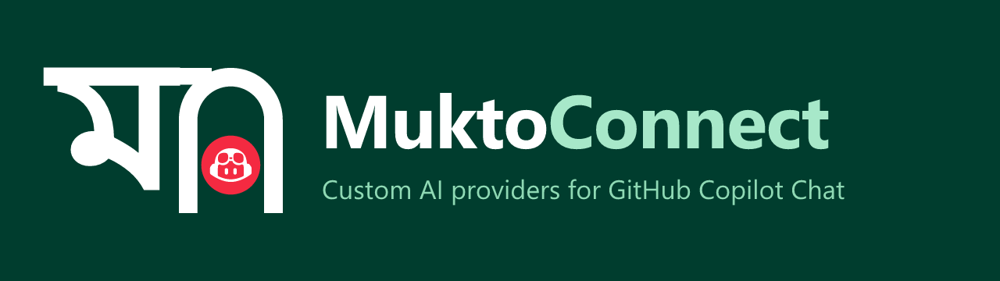

# MuktoConnect



**Custom AI providers and models for GitHub Copilot Chat.**

MuktoConnect (মুক্তসংযোগ) connects custom AI providers to GitHub Copilot Chat as first-class models — including Agent mode — using the Language Model Chat Provider API. It streams responses, supports tool calling, and automatically retries with exponential backoff and fails over to alternative models when providers fail.

[](https://github.com/habibbrox2/MuktoConnect) [](https://github.com/habibbrox2/MuktoConnect/releases/latest)

**[Download Latest Release](https://github.com/habibbrox2/MuktoConnect/releases/latest)**

A sister project of [MuktoDwar](https://github.com/habibbrox2/MuktoDwar). This extension only talks to providers as a client — no MuktoDwar source code is included.

## Brand


| File | Purpose |
|---|---|
| [`assets/icon.svg`](assets/icon.svg) | Source mark — calligraphic Bangla `ম` on Bangladesh-green tile, its matra flows into MuktoDwar's gate crown with the Copilot Chat logo in the doorway |
| [`assets/icon.png`](assets/icon.png) | 128×128 extension icon |
| [`assets/icon-256.png`](assets/icon-256.png), [`assets/icon-512.png`](assets/icon-512.png) | Larger renders |
| [`assets/muktoconnect.ico`](assets/muktoconnect.ico) | Windows icon (16-256) |
| [`assets/logo-dark.svg`](assets/logo-dark.svg) / [`logo-dark.png`](assets/logo-dark.png) | Horizontal lockup for dark surfaces |
| [`assets/logo-light.svg`](assets/logo-light.svg) / [`logo-light.png`](assets/logo-light.png) | Horizontal lockup for light surfaces |

**Design:** Calligraphic Bangla letter `ম` (Nirmala UI) with its headline bar merging into MuktoDwar's gate crown. Flag-red disc (`#F42A41`) in the doorway contains the official GitHub Copilot Chat logo in white, on solid Bangladesh-green (`#006A4E`) background. No gradients.

Regenerate assets: `npm run brand:build`

## Supported Providers

| Vendor | Default URL | Auth | Notes |
|---|---|---|---|
| `muktodwar` | `http://127.0.0.1:8787/v1` | Gateway token | Local MuktoDwar gateway. Default model `mukto-auto/free` routes to allowlisted free models. |
| `kilo` | `https://ai-gateway.kilo.ai/api/v1` | Kilo API key | [Kilo Gateway](https://kilo.ai/). Models like `openai/gpt-5.4`. |
| `opencode` | `https://opencode.ai/inference/openai/v1` | Console API key | [OpenCode Console / Zen](https://opencode.ai/). |
| `custom` | *user-defined* | Optional | Any OpenAI-compatible endpoint (Ollama, LM Studio, vLLM, etc.) |

## Installation

```bash
npm install
npm run compile
```

Run in Extension Development Host: open this folder in VS Code, press `F5`. In the new window, go to Chat → Manage Models and enable **MuktoConnect**. All models from configured backends (MuktoDwar, Kilo, OpenCode, and Custom) appear under this single provider; model names are prefixed with the backend ID to distinguish duplicate model IDs. **Auto** (`muktoconnect:auto`) appears first and starts with an eligible free model across configured backends, then uses the existing cross-provider fallback chain. Provider eligibility checks run concurrently to reduce startup latency, and each response includes a `_Model: provider / model-id_` label for the actual backend that produced it. Existing `chat.defaultModel` values set to `muktoconnect:muktoconnect-auto` are migrated to `muktoconnect:auto`; other user-selected defaults are preserved. If no free model is eligible, it starts with the first eligible model available.

Package and install:
```bash
npx @vscode/vsce package
code --install-extension ./muktoconnect-<version>.vsix
```

**Requirements:** VS Code 1.104+ with `languageModelChatProviders` API support.

## Configuration

Use `MuktoConnect: Manage <Provider> Provider` commands to configure:
- API keys (stored in VS Code SecretStorage)
- Base URLs and model list URLs
- Custom model IDs
- Fallback model chains (e.g., `muktodwar:mukto-auto/free` or `kilo:openai/gpt-5.4`)

**Unified model picker:** MuktoConnect registers one provider in VS Code. Its model list aggregates models from every configured backend and uses vendor-qualified model IDs so the same model ID from two providers does not collide. Use `MuktoConnect: Manage All Providers` to choose a backend to configure.

Provider discovery is intentionally silent. If a required API key or base URL is missing, MuktoConnect exposes no models for that provider and does not show repeated prompts while Copilot Chat refreshes its model list. Configure providers explicitly with the management commands, then refresh the model list.

## Copilot Chat Agent compatibility

MuktoConnect contributes models through VS Code's Language Model Chat Provider API. Tool calling is enabled for exposed models, and the extension translates VS Code messages/tool results to OpenAI Chat Completions format. Agent behavior still depends on the upstream model and endpoint correctly supporting tool calls and the required OpenAI-compatible request format; provider registration alone cannot guarantee parity with every built-in Copilot model. MuktoConnect forwards the tools VS Code supplies (including a sub-agent tool when the host exposes one), but it cannot create or force-enable VS Code sub-agents itself; availability and orchestration remain controlled by VS Code Agent Mode and its configuration.

Verify in a VS Code Extension Development Host with a configured endpoint:
- Agent mode can call a tool and consume its result in a subsequent model turn.
- Multiple tool calls and streamed tool-call arguments are handled correctly.
- Cancellation, rate limits, interrupted streams, and fallback do not duplicate already-visible output or repeat tool execution.
- Models that support image input are not assumed to support it by MuktoConnect; image input remains disabled until multimodal request mapping is implemented and tested.

## Retry & Automatic Fallback

- **Smart retries:** Retries on network errors, timeouts, 408/409/425/429/5xx with exponential backoff + jitter
- **Fast failover:** Skips retries on 4xx client errors (except specific retryable ones)
- **Free-first auto model:** Select `Auto` (`muktoconnect:auto`) to start with an eligible free model across all configured backends.
- **Cross-provider fallback:** Fail over to any configured provider/model
- **Auto-promotion:** Successful fallback models become preferred for future requests
- **Streaming safe:** No restart if output already streamed

Configure via settings under `muktoconnect.*`: `retry.maxAttempts`, `retry.baseDelayMs`, `retry.autoSwitch`, `request.timeoutMs`.

## Development

```bash
npm run compile      # TypeScript compile
npm run test:unit    # Run unit tests
npm run brand:build  # Regenerate brand assets
npm run watch        # Watch mode
```

## Release & Auto-update

Push a stable version tag such as `v0.1.6` after merging the release workflow to `main`. The workflow runs compilation, unit tests, and streaming integration tests before packaging a VSIX and creating a GitHub Release. The tag version is applied to the packaged extension.

To enable automatic updates for users who install MuktoConnect from the VS Code Marketplace, configure a **trusted publishing policy** for publisher `habibbrox2` that allows this GitHub repository and `.github/workflows/release.yml`, then the workflow publishes with GitHub Actions OIDC (`vsce publish --oidc`) without a long-lived Marketplace token. Optionally configure the repository Actions secret `OVSX_PAT` to publish to Open VSX for compatible editors. Marketplace publishing will fail closed until trusted publishing is configured; a GitHub Release/VSIX upload alone does **not** enable automatic updates for manually installed VSIX files. Marketplace-installed extensions use VS Code's built-in auto-update setting.

Do not publish a tag until the workflow changes are merged into `main`, the Marketplace publisher/trusted policy is configured, and any optional Open VSX credentials are ready. Use a new, unused version for every release.

## Testing

- `npm run test:unit` — 28/28 tests passed in the local verification run.
- `npm run test:stream` — 10/10 scenarios passed in the local verification run.
- VSIX packaging and isolated VS Code installation smoke test passed; real GitHub Copilot Agent Edit/Shell behavior still needs an end-to-end VS Code test.

## License

MIT